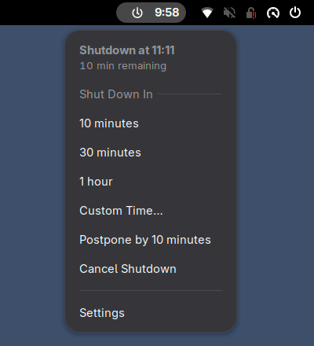
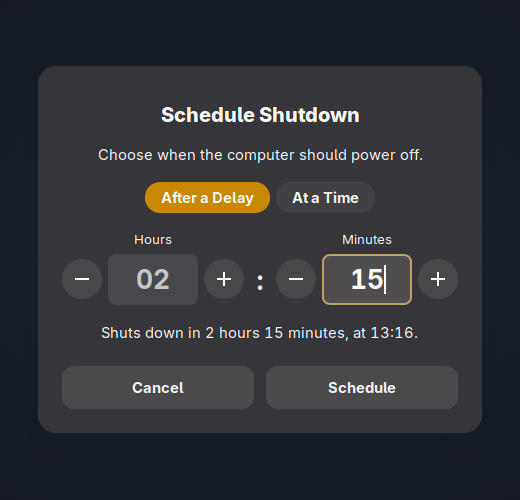
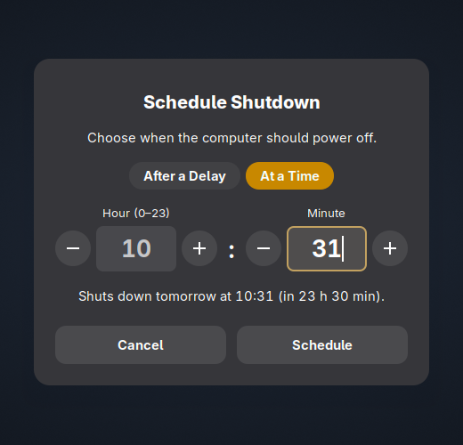
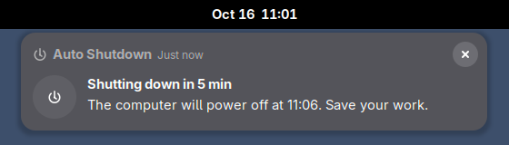
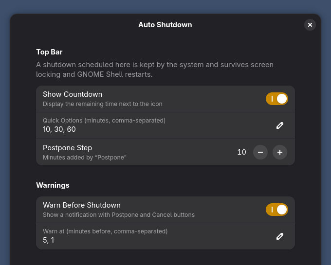

# Auto Shutdown for GNOME

Schedule an automatic shutdown from the GNOME top bar. Pick 10, 30 or 60 minutes, any custom delay, or a time of day. A countdown shows how long is left.



## Features

- **Quick options:** 10 minutes, 30 minutes or 1 hour, in one click. You can change the list.
- **Custom delay:** any number of hours and minutes, up to 99 h 59 min.
- **Time of day:** shut down at, say, 23:30. A time that has already passed today means tomorrow.
- **Countdown** next to the top bar icon.
- **Warnings** 5 minutes and 1 minute before, with **Postpone** and **Cancel** buttons. You can change the times.
- **Postpone** and **Cancel** are also in the menu.
- **Dry-run mode** for trying it out without powering off.

| After a delay | At a time |
| --- | --- |
|  |  |



## How it works

The extension doesn't run its own timer. It hands the shutdown to **systemd-logind** through its `ScheduleShutdown` D-Bus method, the same one `shutdown +N` uses.

- **No lost timers:** the shutdown still happens if the screen locks or GNOME Shell restarts. GNOME turns extensions off on the lock screen, so a timer kept inside the extension would stop there.
- **Works with the terminal:** a schedule set with `shutdown +N` shows up in the menu, and `shutdown -c` cancels one set from the menu.
- **No root or helper service:** as the logged-in user you can power off without a password. If other users are logged in, polkit asks for an administrator password, as it does for a normal shutdown.

## Requirements

- GNOME Shell 48 or later. Tested on GNOME Shell 51.
- systemd (logind).

## Installation

### Debian / Ubuntu package

Download the `.deb` from the [latest release](https://github.com/itowhid06/gnome-auto-shutdown/releases/latest) and install it:

```bash
sudo apt install ./gnome-shell-extension-auto-shutdown_*_all.deb
```

Log out and back in (GNOME on Wayland only finds new extensions at login). Then enable it in the **Extensions** app, or run:

```bash
gnome-extensions enable auto-shutdown@itowhid06.github.io
```

To uninstall:

```bash
sudo apt remove gnome-shell-extension-auto-shutdown
```

### From source

You need `make`, `python3`, `dpkg-deb` and `glib-compile-schemas` (from `libglib2.0-bin`).

```bash
git clone https://github.com/itowhid06/gnome-auto-shutdown.git
cd gnome-auto-shutdown

make deb            # builds dist/*.deb and an extension zip
make install-deb    # installs the .deb with apt (asks for sudo)
# or, for your user only, without a package:
make install-user
```

Log out and back in, then enable the extension as shown above.

## Settings

Open **Settings** from the menu, or run `gnome-extensions prefs auto-shutdown@itowhid06.github.io`.



| Setting | Default |
| --- | --- |
| Show countdown | On |
| Quick options (minutes) | 10, 30, 60 |
| Postpone step | 10 minutes |
| Warn before shutdown | On |
| Warn at (minutes before) | 5, 1 |
| Dry run | Off. When on, logind runs a `dry-poweroff`: everything behaves as usual, but the computer stays on. |

## Troubleshooting

- **The icon doesn't appear after installing.** Log out and back in, then check that the extension is enabled with `gnome-extensions info auto-shutdown@itowhid06.github.io`.
- **You're asked for a password.** Another user is logged in, so polkit requires an administrator to power off.
- **A shutdown is scheduled but you didn't set one.** It was set from a terminal or another tool. Use **Cancel Shutdown** in the menu, or run `shutdown -c`.
- **Logs:** run `journalctl --user -b | grep -i "auto shutdown"`.

## Development

```
src/                 the extension (GJS ES modules)
  extension.js       top bar indicator, menu, countdown and warnings
  dialog.js          custom delay / time-of-day dialog
  logind.js          systemd-logind D-Bus wrapper
  util.js            formatting helpers
  prefs.js           preferences window (libadwaita)
  schemas/           GSettings schema
packaging/debian/    control template, postinst, copyright and changelog
scripts/             build and test scripts
```

| Command | What it does |
| --- | --- |
| `make deb` | Builds `dist/gnome-shell-extension-auto-shutdown_<version>_all.deb` and `dist/<uuid>.shell-extension.zip`. |
| `make test` | Loads the extension in a throwaway headless GNOME Shell and checks the menu, dialog, notifications and logind state. Screenshots go to `build/test-output/`. |
| `make screenshots` | Runs the same test and refreshes the README images in `docs/screenshots/`. |
| `make install-user` / `make uninstall-user` | Installs or removes the extension in `~/.local/share/gnome-shell/extensions/`. |

About `make test`:

- **Isolated:** the test shell has its own session bus, dconf database and data directories, so your desktop settings are not touched.
- **Safe:** it turns dry-run mode on, so logind never powers off. While it runs, logind still sends its usual "system is going down" messages to open terminals.
- **Refuses to clobber:** it won't start if a shutdown is already scheduled.

### Releasing

1. Bump `version-name` in `src/metadata.json`.
2. Add an entry to `packaging/debian/changelog`.
3. Commit, then tag the commit as `v<version>` and push the tag.

The GitHub Actions workflow builds the package and attaches the `.deb` and the zip to a GitHub release.

## License

[GPL-2.0-or-later](LICENSE).
